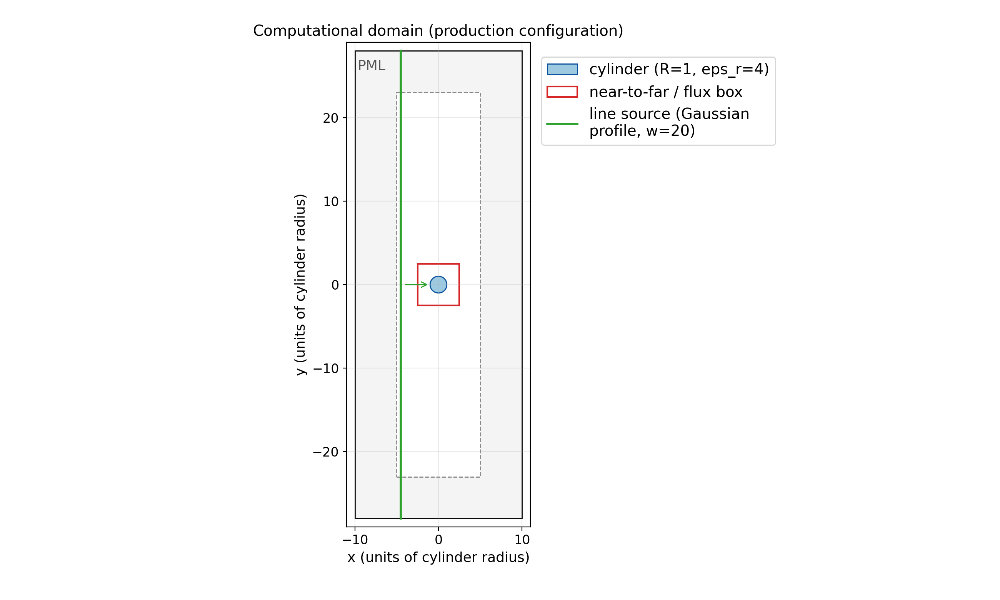

# Numerical method

All simulations use [MEEP](https://meep.readthedocs.io) and the finite-difference time-domain (FDTD) method, driven by the code in `src/em_rf_lab`. The software-method reference is [Oskooi et al. (2010), *Meep: A Flexible Free-Software Package for Electromagnetic Simulations by the FDTD Method*](https://doi.org/10.1016/j.cpc.2009.11.008). This document describes the grid, source, monitors, normalization, and stopping criteria. Verification against analytical reference solutions is described in [`03_verification_validation.md`](03_verification_validation.md).

## FDTD discretization

Maxwell's curl equations are discretized on the staggered grid introduced by [Yee (1966), *Numerical Solution of Initial Boundary Value Problems Involving Maxwell's Equations in Isotropic Media*](https://doi.org/10.1109/TAP.1966.1138693).  The electric- and magnetic-field components are staggered in space and advanced in leapfrog fashion in time. In The time step is set by the Courant factor and the spatial grid spacing, using MEEP units with $c=1$. For smooth fields, the Yee scheme is second-order accurate in space and time. Its numerical dispersion error therefore decreases approximately as $O(N^{-2})$, where $N$ is the number of grid points per wavelength. The exact coefficient depends on propagation direction, dimensionality, and Courant number, so the grid is judged against the shortest wavelength that occurs in the simulation rather than against a single universal phase-error formula.

For a dielectric with refractive index

$$
n=\sqrt{\varepsilon_r},
$$

the wavelength is reduced from its vacuum value by a factor of $n$. The shortest wavelength in the dielectric is therefore

$$
\lambda_{\mathrm{diel,min}}
=
\frac{2\pi}{n k_{\max}}
=
\frac{1}{n f_{\max}},
$$

because $k=2\pi f$ in MEEP units. In this project $\varepsilon_r=4$, so $n=2$. With $ka_{\max}=6$ and $a=1$,

$$
k_{\max}=6,
\qquad
f_{\max}=\frac{6}{2\pi}\approx0.955,
$$

and therefore

$$
\lambda_{\mathrm{diel,min}}
=
\frac{2\pi}{2(6)}
=
\frac{\pi}{6}
\approx0.524
$$

length units. A resolution of 20 thus gives

$$
20\times0.524\approx10.5
$$

grid points per shortest in-medium wavelength.

MEEP uses subpixel smoothing at dielectric interfaces, replacing a sharp curved boundary by an effective anisotropic permittivity in boundary pixels. This treatment follows [Farjadpour et al. (2006), *Improving Accuracy by Subpixel Smoothing in the Finite-Difference Time Domain*](https://doi.org/10.1364/OL.31.002972), and is implemented in MEEP as described by [Oskooi et al. (2010), *Meep: A Flexible Free-Software Package for Electromagnetic Simulations by the FDTD Method*](https://doi.org/10.1016/j.cpc.2009.11.008). This improves the treatment of curved dielectric interfaces and gives cleaner convergence than a simple staircased representation. The dielectric cylinder is therefore used for the grid-convergence study rather than a staircased PEC boundary.

## Setup of the cylinder-scattering calculation

| Item                | Choice                                                                                                                      |
| ------------------- | --------------------------------------------------------------------------------------------------------------------------- |
| Dimensionality      | 2-D ($xy$), structure invariant in $z$                                                                                      |
| Scatterer           | circular cylinder, $a=1$, $\varepsilon_r=4$ (lossless)                                                                      |
| Polarization        | TM ($E_z$, primary) and TE ($H_z$)                                                                                          |
| Source              | broadband Gaussian-pulse line source at $x=-4.5$, spanning the full cell height; amplitude profile $\exp[-(y/w)^2]$, $w=20$ |
| Frequencies         | $ka\in[2,6]$, 41 uniformly spaced DFT frequencies                                                                           |
| Boundaries          | PML, thickness 5, all four sides                                                                                            |
| Cell                | $20\times56$ (including PML)                                                                                                |
| Near-to-far surface | closed square box of half-width 2.5 around the cylinder; the same box is used for scattered flux                            |
| Observation         | far field evaluated at $\rho=10^5$, 91 angles                                                                               |
| Termination         | stop after the axial field at an interior probe has decayed below the specified tolerance, subject to a minimum run time    |
| Symmetry            | mirror $y\to-y$; verified against the full-domain calculation for both polarizations                                        |

**Fig. 1. Computational domain and monitor geometry.** The source line, closed near-to-far/flux box, and PML are shown to scale; the dashed rectangle is the PML-free region.

## Reference and scattering runs

The scattering calculation is split into two simulations.

1. **Reference run (vacuum).** The empty-cell run records the complex incident field $F_{\mathrm{inc}}(\omega)$ at the origin, the near-field and flux data on the monitor box, and the incident transverse profile along $y$ at $x=0$.
2. **Scattering run (cylinder).** The stored reference fields are subtracted using MEEP's `load_minus_near2far_data` and `load_minus_flux_data`, leaving only the scattered contribution in the corresponding monitors.

The two-dimensional echo width is then obtained from the near-to-far transform,

$$
W(\phi)
=
2\pi\rho\,
\frac{|F_s(\rho,\phi)|^2}{|F_{\mathrm{inc}}(0)|^2}.
$$

The total scattering width is also computed independently from the scattered Poynting flux through the closed monitor box. The incident intensity is

$$
I_0=\frac12|F_{\mathrm{inc}}|^2.
$$

MEEP's DFT flux convention uses $\operatorname{Re}(\mathbf E\times\mathbf H^*)$ without the factor $1/2$, so the corresponding normalization is handled explicitly in the code. Each run also records `flux_norm_check`, which compares the measured transverse flux against the integral of the incident intensity profile.

Agreement between the far-field integral and the scattered-flux estimate provides an internal consistency check on the near-to-far calculation.

## Finite-width incident field

The source is a finite Gaussian-tapered line source rather than an infinite plane wave. A hard-edged aperture would introduce stronger diffraction, so the Gaussian profile is used to suppress edge effects. The remaining departure from a plane wave comes from amplitude variation across the cylinder and the finite angular spread of the beam.

These effects are tested explicitly by varying the beam waist and transverse cell size. The chosen production geometry keeps the corresponding error below the dominant grid-discretization error over the frequency range used for the benchmark.

## Run duration and narrow resonances

A frequency-domain quantity accumulated over a finite time $T$ has an effective spectral resolution of order $1/T$. High-$Q$ resonances decay slowly; a characteristic ringdown time is of order

$$
\tau\sim\frac{Q}{\pi f}.
$$

For this reason, the stopping condition cannot rely only on a short decay measurement at an arbitrary point. The original center-near probe underestimated the lifetime of rim-localized resonances. The production configuration instead uses a probe near the cylinder rim together with a minimum run time and a tighter decay threshold. The corresponding run-time study is documented in [`03_verification_validation.md`](03_verification_validation.md).

## Reproducibility

Each run is associated with a hash of its complete [`SimulationConfig`](../src/em_rf_lab/config.py). The run directory stores:

- `config.json` — physical and numerical inputs;
- `meta.json` — run metadata, including library versions, wall time, and termination information;
- `arrays.npz` — numerical arrays used for analysis and plotting.

Raw MEEP HDF5 output is not retained in the repository.
