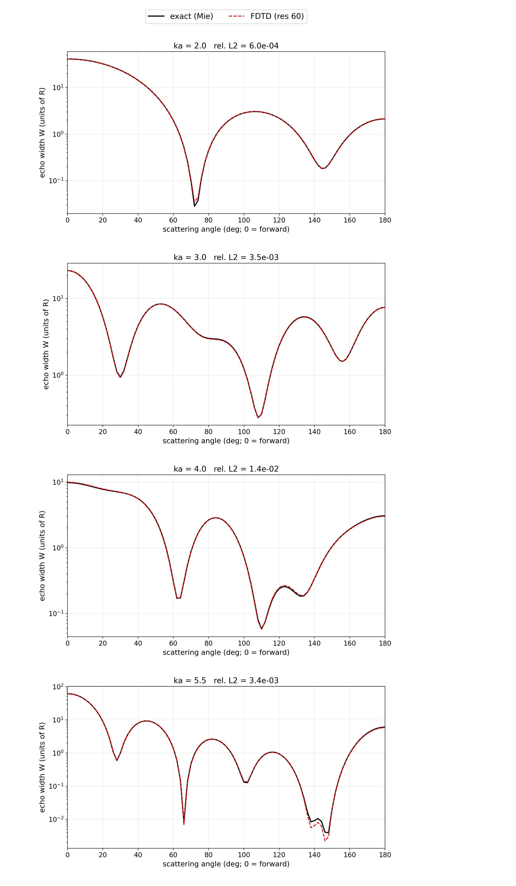
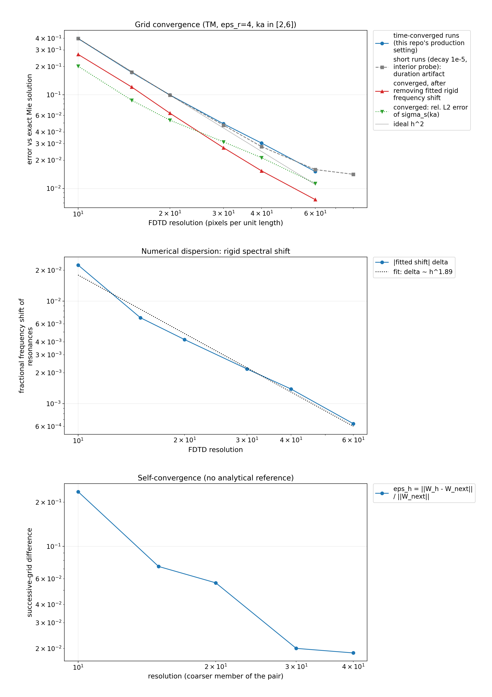
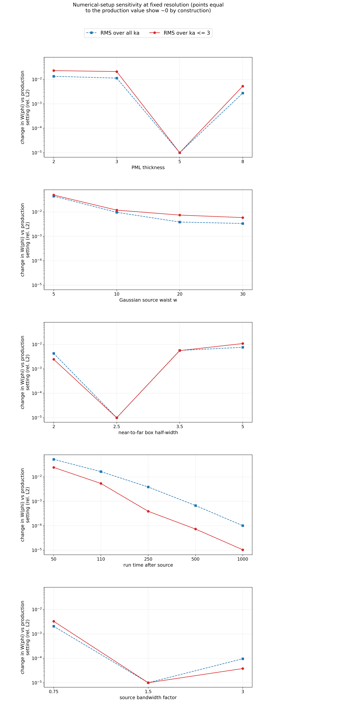
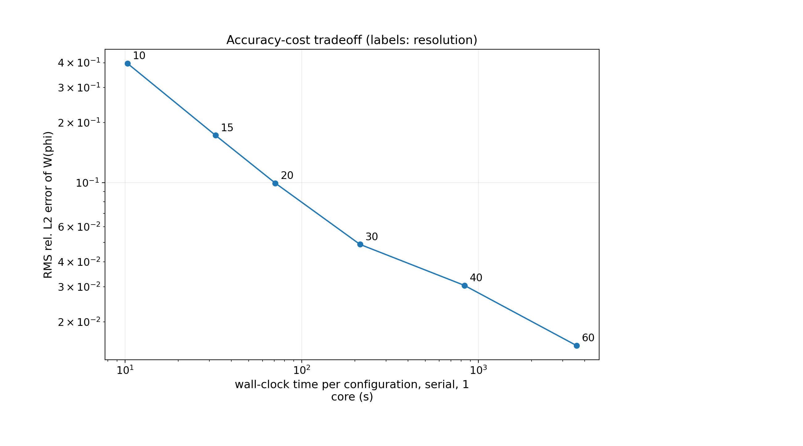
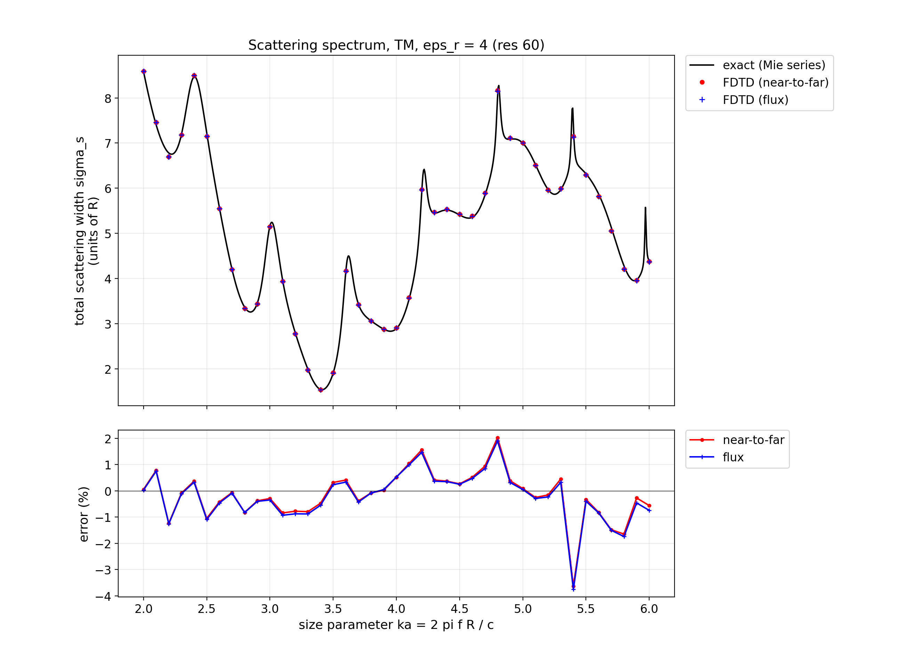
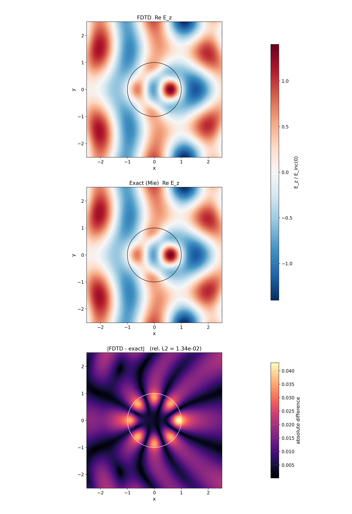
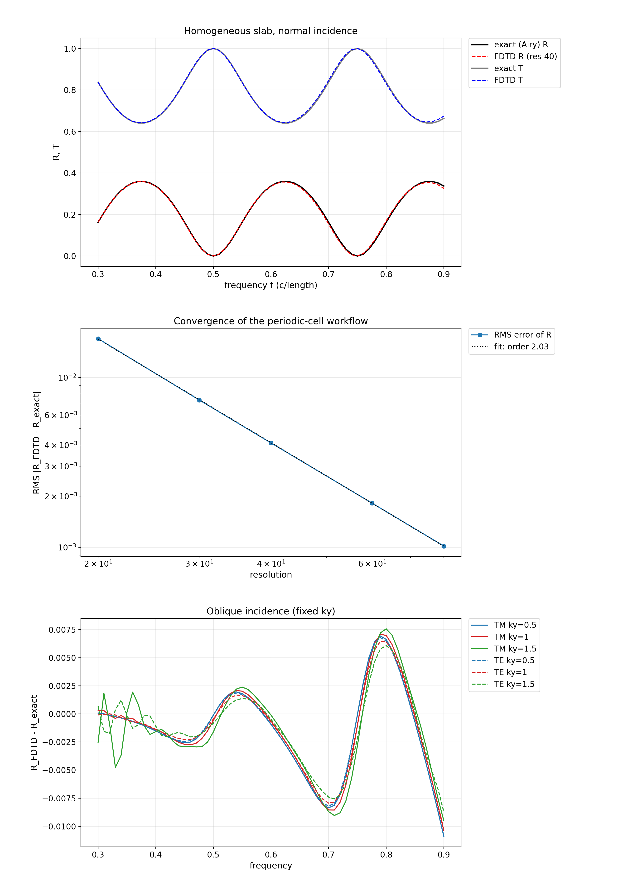
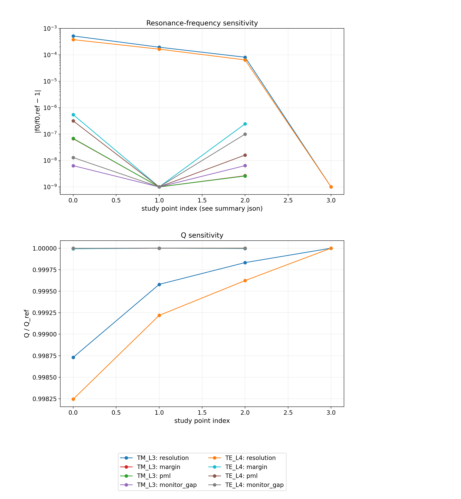

# Verification and validation

The FDTD calculations are compared with two analytical references: the cylindrical Mie solution for single-cylinder scattering and the Airy/transfer-matrix solution for a homogeneous slab. Scripts in `experiments/` generate the data stored in `results/`; figures are generated by `scripts/make_tier*_figures.py`.

## 1. Cylinder scattering versus exact Mie theory

Configuration: TM polarization, circular dielectric cylinder with $\varepsilon_r=4$, $ka\in[2,6]$ sampled at 41 frequencies, and 91 observation angles.

The primary error metric is the relative $L^2$ error of the angular echo width $W(\phi)$ at each frequency, followed by an RMS over frequency.



**Fig. 2. FDTD and exact Mie angular scattering patterns.**

**(a) $ka=2.0$.** Exact Mie result (black) and resolution-60 FDTD result (red dashed) are nearly indistinguishable; the relative $L^2$ error is $6.0\times10^{-4}$.

**(b) $ka=3.0$.** The FDTD calculation reproduces the additional angular structure that develops as the cylinder becomes electrically larger; the relative $L^2$ error is $3.5\times10^{-3}$.

**(c) $ka=4.0$.** The scattering pattern contains deeper minima and stronger multipole structure. The relative $L^2$ error is $1.4\times10^{-2}$.

**(d) $ka=5.5$.** The exact and FDTD curves remain closely aligned despite the more rapidly varying angular pattern; the relative $L^2$ error is $3.4\times10^{-3}$.

In all four panels, $W(\phi)=2\pi\rho|F_s|^2/|F_i|^2$, TM polarization, and $\varepsilon_r=4$.


### 1.1 Grid convergence

| Resolution (px/unit) | RMS rel. L2 error of $W$ | Error of $\sigma_s(ka)$ (L2) | Fitted dispersion shift $\delta$ |
|---|---|---|---|
| 10 | 0.397 | 0.201 | 2.25e-2 |
| 15 | 0.173 | 0.087 | 6.9e-3 |
| 20 | 0.099 | 0.054 | 4.2e-3 |
| 30 | 0.049 | 0.031 | 2.2e-3 |
| 40 | 0.030 | 0.021 | 1.4e-3 |
| 60 | 0.015 | 0.011 | 6.4e-4 |

The RMS echo-width error decreases monotonically as the grid is refined. The project analysis gives an observed convergence order of approximately 1.74 over resolutions 20--60. A fit performed directly on the rounded values printed in the table gives about 1.72, so the displayed table should be interpreted as a rounded summary rather than as the source of the fitted value.

The fitted fractional spectral shift $\delta$ also decreases with resolution. Its fitted convergence order is 1.89, close to the second-order behavior expected from numerical dispersion in the Yee scheme. The table lists the fitted shift itself; it does not list the error after correcting for that shift.

A separate shift-correction analysis aligns the numerical spectrum with the exact spectrum using the fitted fractional frequency shift. That correction reduces the RMS echo-width error by roughly a factor of 1.5--2, depending on resolution. The result indicates that spectral displacement accounts for a substantial part of the total error, while the remaining discrepancy is associated with changes in line shape and amplitude.

At resolution 60, the largest single-frequency discrepancy is 6.1% near the narrow resonance at $ka\approx5.4$, where a small horizontal frequency shift produces a much larger vertical amplitude difference. Away from the narrow resonances the discrepancy is much smaller; at $ka=2$ it is about $6\times10^{-4}$.

Self-convergence between successive grids is shown in `figures/tier1_convergence.png`.



**Fig. 3. Grid convergence, numerical dispersion, and self-convergence.**

**(a) Grid convergence.** The time-converged FDTD error decreases monotonically with resolution. The gray short-run series shows the artificial high-resolution error floor caused by the original stopping criterion. The red series shows the remaining error after removing the fitted rigid spectral shift, and the green series shows the total-scattering-width error. The dotted reference line indicates ideal second-order behavior.

**(b) Numerical dispersion.** The fitted fractional resonance shift $|\delta|$ decreases with resolution with fitted order 1.89, close to the expected second-order trend of the Yee discretization.

**(c) Self-convergence.** Successive-grid differences decrease as the grid is refined, providing a convergence check that does not use the analytical Mie reference. The reported local orders of the converged RMS error are 2.05, 1.92, 1.75, 1.65, and 1.72.


### 1.2 Domain, source, and duration sensitivity

The following comparisons were made at resolution 30. Percentages are RMS differences relative to the production setting.

| Parameter | Values tested | Effect on echo-width error (RMS, vs production) |
|---|---|---|
| PML thickness | 2, 3, **5**, 8 | 1.3 %, 1.1 %, –, 0.3 % |
| Beam waist | 5, 10, **20**, 30 | 4.4 %, 0.97 %, –, 0.34 % |
| Near-to-far box half-width | 2, **2.5**, 3.5, 5 | 0.4 %, –, 0.6 %, 0.8 % |
| Minimum run time | 50, 110, 250, **500**, 1000 | 5.3 %, 1.7 %, 0.39 %, 0.07 %, 0.01 % |
| Source bandwidth | 0.75, **1.5**, 3.0 × | 0.20 %, –, 0.01 % |

With the production settings, these effects are at or below about 0.5%, below the 3–5% discretization error at resolutions 30–40. At the low-$ka$ end of the band, a small beam waist or thin PML has a larger effect: 4.9% and 2.3% RMS, respectively. The production values $w=20$ and PML thickness 5 were chosen to suppress those contributions.



**Fig. 4. Numerical-setup sensitivity.** Each panel varies one numerical parameter while holding the others fixed. Blue squares show RMS change over the full $ka$ band; red circles restrict the RMS to $ka\le3$. Points at the production value are approximately zero by construction.

**(a) PML thickness.** Thin PML layers produce the largest change; thickness 5 is the production value.

**(b) Gaussian source waist $w$.** Narrow beams depart more strongly from plane-wave illumination, especially at low $ka$; $w=20$ is the production value.

**(c) Near-to-far box half-width.** Moving the closed monitor surface over the tested range changes the result only weakly around the production value 2.5.

**(d) Run time after the source.** Short runs give the largest sensitivity. The result approaches the production solution as the post-source run time is increased.

**(e) Source-bandwidth factor.** The production factor 1.5 is stable relative to the narrower and broader source choices tested.


### 1.3 Run-duration artifact

An early resolution ladder stopped when a field probe near the cylinder center had decayed to $10^{-5}$ of its peak. Its error stopped improving at about 1.4% for resolutions 60 and above.

The plateau was caused by the stopping criterion rather than the spatial discretization. The narrow whispering-gallery-like resonances are concentrated near the cylinder rim and can have little amplitude at the center. A center probe can therefore satisfy the decay criterion while a long-lived rim mode is still ringing.

Moving the probe to $r=0.9a$, tightening the threshold to $10^{-6}$, and imposing a minimum post-source run time of 500 removed the plateau. The original short-run results are retained under `results/shortrun/`. A separate test of simply extending the run while leaving the probe at the same location did not solve the problem.



**Fig. 5. Accuracy-cost tradeoff.** Error versus wall-clock cost of one full reference-plus-scattering configuration with 41 frequencies and 91 angles, run serially on one core.


### 1.4 Additional checks




**Fig. 6. Total scattering-width spectrum and signed error.**

**(a) Total scattering-width spectrum.** The exact Mie series (black) is compared with two independent FDTD estimates: integration of the near-to-far field (red circles) and scattered flux through the closed monitor box (blue crosses). Their agreement provides an internal consistency check on the normalization and near-to-far transformation.

**(b) Signed relative error.** Errors of the two FDTD estimators relative to the exact result remain small over most of the band and track one another closely. The largest excursions occur near narrow spectral features where a small frequency shift produces a larger amplitude error.




**Fig. 7. Near-field comparison between FDTD and the exact Mie solution.** Complex near field at $ka=3$ (TM, $\varepsilon_r=4$, resolution 40), normalized by the incident amplitude.

**(a) FDTD $\operatorname{Re}E_z$.** Real part of the MEEP DFT field around the cylinder.

**(b) Exact Mie $\operatorname{Re}E_z$.** Real part of the analytical interior/exterior cylindrical-series solution evaluated on the same spatial grid.

**(c) Absolute difference.** Pointwise $|E_{z,\mathrm{FDTD}}-E_{z,\mathrm{exact}}|$. The relative $L^2$ difference over the plotted patch is $1.339\times10^{-2}$.

- Mirror symmetry reduces the computational domain by half and reproduces the corresponding full-domain TM and TE runs to $10^{-13}$.
- The total scattering width obtained by integrating the far field agrees with the value obtained from scattered flux through the monitor box, and both agree with the exact Mie result at the levels shown above.
- `flux_norm_check` is 1.000 for the reference-run normalization.
- Unit tests for the analytical solution cover the optical theorem, angular integration of echo width, interface conditions, a direct $2\times2$ boundary solve, the Rayleigh limit and scaling exponent, the PEC geometric-optics limit, and multipole-truncation convergence.

## 2. Periodic-cell verification with an exact slab

A homogeneous slab with refractive index $n=2$ and thickness $d=1$ has a closed-form Airy/transfer-matrix solution implemented in `periodic.slab_rt`. The MEEP slab calculation uses the same periodic-cell machinery as the cylinder array: Bloch boundary conditions, oblique source phase, flux normalization, and PML.



**Fig. 8. Periodic-cell verification against the exact slab solution.** Verification of the periodic-cell workflow against the exact Airy/transfer-matrix solution for a homogeneous slab.

**(a) Normal-incidence spectra.** Exact and FDTD reflectance $R$ and transmittance $T$ lie nearly on top of one another at resolution 40.

**(b) Grid convergence.** The RMS reflectance error decreases with resolution with fitted order 2.03.

**(c) Oblique-incidence residuals.** $R_{\mathrm{FDTD}}-R_{\mathrm{exact}}$ is shown for TM and TE at fixed $k_y=0.5$, 1, and 1.5. The largest residuals occur in the most oblique case, especially toward the low-frequency end of the scan.


At normal incidence, the RMS reflectance error is

- $1.7\times10^{-2}$ at resolution 20,
- $7.4\times10^{-3}$ at resolution 30,
- $4.1\times10^{-3}$ at resolution 40,
- $1.8\times10^{-3}$ at resolution 60,
- $1.0\times10^{-3}$ at resolution 80.

The fitted convergence order is 2.03 for both TM and TE, as expected for a homogeneous layer.

At fixed transverse wavenumbers $k_y=0.5$, 1, and 1.5, using resolution 40, the maximum absolute reflectance error is

$$
|R_\text{FDTD}-R_\text{exact}|\le1.1\times10^{-2}.
$$

The normal-incidence energy residual satisfies

$$
|1-R-T|\le1.2\times10^{-4}.
$$

At $k_y=1.5$, the residual reaches about 1.2–1.6% at the lowest frequencies in the scan ($f=0.30$–0.34$), where $\sin\theta=k_y/k\approx0.8$. This is attributed to the finite source and monitor geometry near grazing incidence. No conclusions in this repository use cases with $\sin\theta>0.7$.

## 3. Convergence of periodic-array resonance metrics

The lowest resonance was studied for two representative cases with 321-point frequency windows.

| Case | Variation | $f_0$ range | $Q$ range |
|---|---|---|---|
| TM, $\Lambda=3$ | resolution 20→60 | 0.25470 → 0.25483 (5×10⁻⁴ relative) | 64.9 → 65.0 |
| TM, $\Lambda=3$ | margin 4–9, PML 3–6, monitor gap 2–5 | 0.25481 (identical to 5 digits) | 65.0 |
| TE, $\Lambda=4$ | resolution 20→60 | 0.19863 → 0.19870 (3.5×10⁻⁴) | 12.1 |
| TE, $\Lambda=4$ | margin, PML, monitor gap | 0.19869 | 12.1 |

The resonance frequency changes by less than $10^{-3}$ relative at resolution 20 and above. No dependence on boundary or monitor placement is resolved at the quoted precision. Resolution 40 is used for the parameter studies.



**Fig. 9. Sensitivity of periodic-array resonance metrics.** The legend applies to both panels. Study-point indices correspond to the values stored in the summary JSON.

**(a) Resonance-frequency sensitivity.** Relative changes $|f_0/f_{0,\mathrm{ref}}-1|$ are shown for grid resolution, structure-to-PML margin, PML thickness, and monitor gap for TM at $\Lambda=3$ and TE at $\Lambda=4$. Resolution produces the largest visible change, while the other setup variations are much smaller.

**(b) $Q$ sensitivity.** $Q/Q_{\mathrm{ref}}$ stays very close to unity. Only the two resolution series contain a fourth point; the six margin, PML, and monitor-gap series differ from unity by less than $10^{-5}$ and therefore overlap visually.


## 4. Independent estimates of $Q$

The spectral $Q$ obtained from a coupled-mode fit to $R(f)$ is compared with a time-domain Harminv ringdown estimate. Harminv uses harmonic inversion / filter diagonalization; the underlying method is described by [Mandelshtam and Taylor (1997), *Spectral Analysis of Time Correlation Function for a Dissipative Dynamical System Using Filter Diagonalization*](https://doi.org/10.1103/PhysRevLett.78.3274).

For TM at $\Lambda=3$, the line-shape fit gives 59.7 over the wider window and 65.0 over the fine window, while Harminv gives 62.7. The estimates agree to within about 7%.

Broad resonances with $Q\lesssim10$ are less well described by a single-Lorentzian model because of the Fano background. In that regime the line-shape fit and FWHM estimate can differ by as much as a factor of two, and Harminv does not reliably identify the modes. Values below about 10 are therefore treated as indicative rather than precise.

## 5. Current limitations

- The periodic-array spectra have not yet been checked against a second independent full-wave method such as RCWA. The present checks are the exact slab comparison, energy conservation, convergence studies, and the ringdown cross-check.
- The coarse 551-point pitch survey cannot resolve lines much narrower than about $4\times10^{-4}$ in frequency ($Q\gtrsim700$). Some short-pitch TM runs also did not fully decay within the coarse-run time limit. Those points are flagged in [`05_results.md`](05_results.md) and are not used for quantitative conclusions.
- The model is two-dimensional and assumes a lossless, nondispersive dielectric.

## 6. Re-running the checks

The README contains the full commands. The main test groups are:

```bash
pytest -m "not meep"
pytest -m meep
pytest -m results
```
