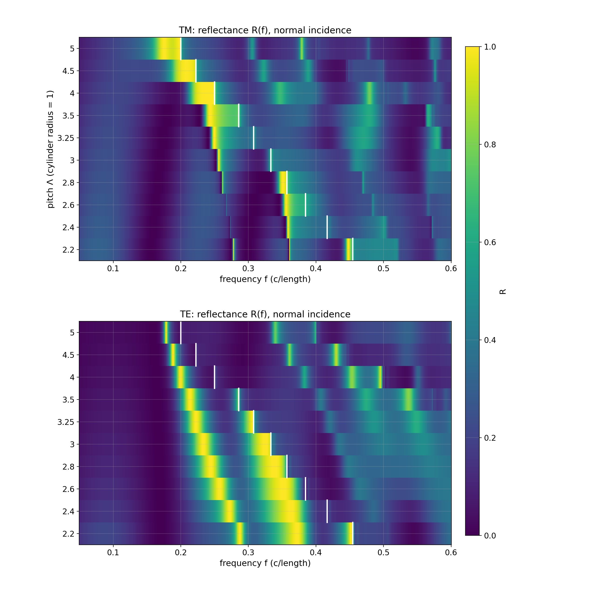
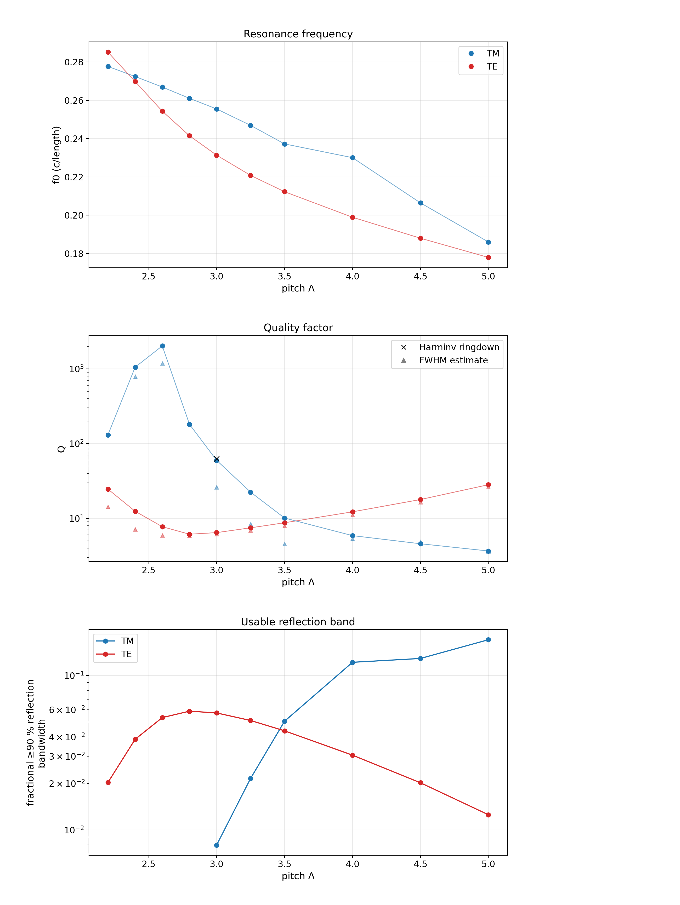
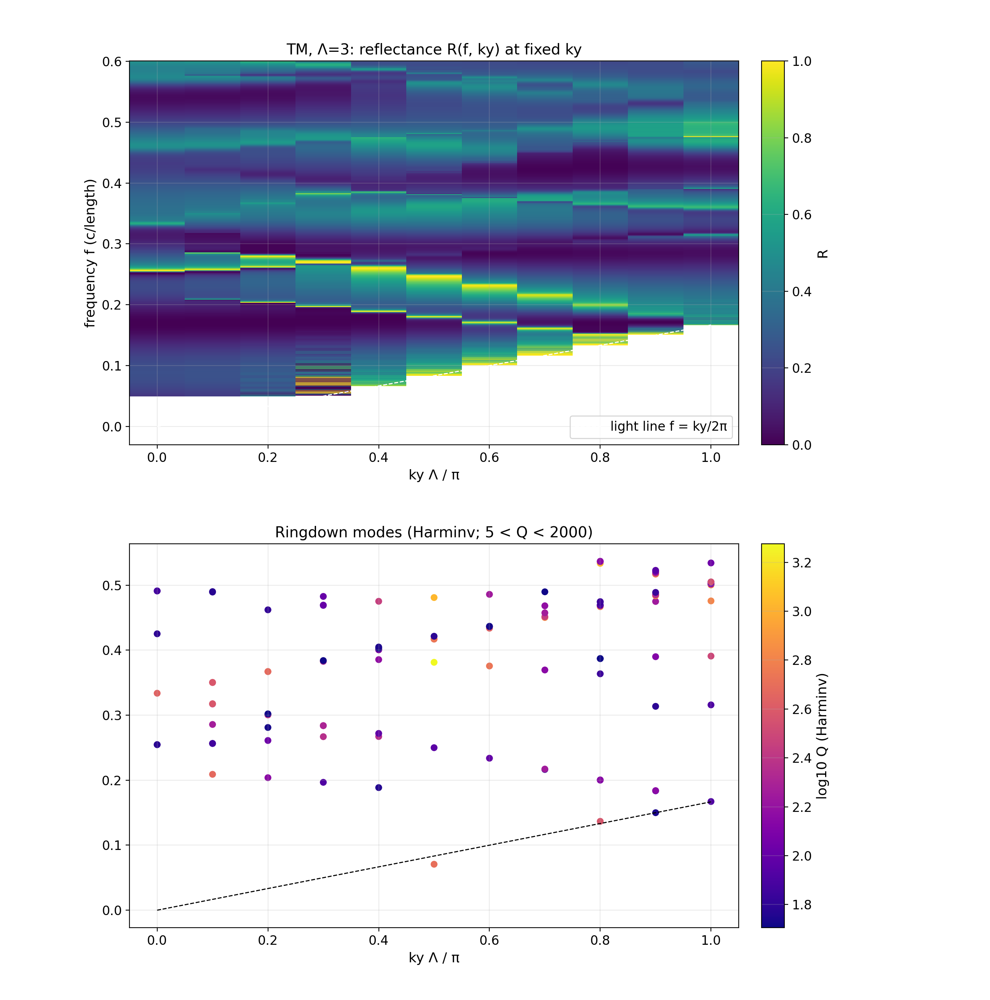

# Results

Numerical values are generated by the scripts listed in the README and stored in `results/`. Figures are in `figures/`, with a companion `.txt` caption for each figure. Lengths are measured in units of the cylinder radius ($a=1$), and frequencies in $c/a$.

## 1. Cylinder-array pitch study

The main parameter sweep uses a one-dimensional array of cylinders with $\varepsilon_r=4$ at normal incidence.

### 1.1 Coarse reflectance survey

`experiments/tier2/pitch_study.py` evaluates 20 cases: TM and TE polarization at ten pitches from 2.2 to 5.0, using resolution 40 and 551 frequencies over $f=0.05$–0.60.

The reflectance maps in `figures/tier2_pitch_maps.png` show broad, strongly reflecting TE bands that move smoothly with pitch. The TM spectrum contains much narrower features at short pitch and broader features at larger pitch. For the resolved peaks, the lossless energy residual satisfies $|1-R-T|<10^{-2}$ except where noted below.

**Fig. 10. Normal-incidence reflectance versus pitch.** Coarse 551-frequency survey of normal-incidence reflectance for a dielectric-cylinder array with $a=1$ and $\varepsilon_r=4$. Color gives reflectance $R$ from 0 to 1; white ticks mark the first Rayleigh-Wood anomaly $f=c/\Lambda$.

**(a) TM polarization.** Short-pitch arrays contain extremely narrow high-reflectance lines. Several are narrower than the coarse frequency spacing and are therefore re-examined with fine-window and long-ringdown calculations. At larger pitch, the dominant reflection features move to lower frequency and broaden.

**(b) TE polarization.** The dominant TE response is broader than the short-pitch TM response. The strong-reflection band shifts to lower frequency with increasing pitch and reaches its largest 90% reflection bandwidth near $\Lambda\approx2.8$.

The short-pitch TM cases require additional care. Runs at $\Lambda=2.2$–2.8 did not reach the $10^{-7}$ decay threshold within 1500 time units, and the coarse frequency spacing of $10^{-3}$ is larger than the width of some lines, which can be $3\times10^{-4}$ or less. Quantitative values for these cases therefore come from the refined calculations described next rather than from the coarse survey.

### 1.2 Lowest strong reflection resonance

The reported branch is the lowest-frequency reflection peak with $R_\text{peak}>0.3$ found in the survey. Each selected peak is re-simulated in a 321-point window spanning $\pm25\%$ and fitted with the coupled-mode model. For TM at $\Lambda\le2.8$, the narrow mode is also analyzed with a 4000-time-unit Harminv ringdown and checked in a 161-point reflectance window of width $\pm0.5\%$.

| $\Lambda$ | TM $f_0$ | TM $Q$ | TM ≥90 % band | TE $f_0$ | TE $Q$ | TE ≥90 % band |
|---|---|---|---|---|---|---|
| 2.2 | 0.2777 | 131 (ringdown) | – | 0.2852 | 24.6 | 2.0 % |
| 2.4 | 0.2725 | ≈1050 (ringdown; approx.) | – | 0.2698 | 12.5 | 3.9 % |
| 2.6 | 0.2670 | ≈2020 (ringdown; approx.) | – | 0.2543 | 7.7 | 5.3 % |
| 2.8 | 0.2611 | 181 (ringdown) | – | 0.2415 | 6.1 | 5.9 % |
| 3.0 | 0.2555 | 59.7 (fit) / 65.0 (fine window) / 62.7 (Harminv) | 0.8 % | 0.2314 | 6.5 | 5.7 % |
| 3.25 | 0.2469 | 22.4 | 2.2 % | 0.2208 | 7.5 | 5.1 % |
| 3.5 | 0.2372 | 10.1 | 5.1 % | 0.2123 | 8.7 | 4.4 % |
| 4.0 | 0.2301 | 5.9 | 12.2 % | 0.1990 | 12.2 | 3.0 % |
| 4.5 | 0.2065 | 4.6 | 12.9 % | 0.1880 | 17.9 | 2.0 % |
| 5.0 | 0.1861 | 3.7 | 17.0 % | 0.1780 | 28.2 | 1.3 % |

**Fig. 11. Lowest strong reflection resonance versus lattice pitch.**

**(a) Resonance frequency.** The selected TM and TE resonance branches both move to lower frequency as pitch increases.

**(b) Quality factor.** Filled circles show the primary reported $Q$ values. Black crosses show Harminv ringdown estimates where Harminv identifies the same mode; gray triangles show model-free FWHM estimates, which tend to be lower for broad Fano-like lines. The short-pitch TM values at $\Lambda=2.2$–2.8 come from long ringdowns; the $Q$ values near 2.4 and 2.6 are approximate because the ringdown is only marginally converged.

**(c) Usable reflection band.** Fractional bandwidth with $R\ge0.9$. The TE branch is broadest near $\Lambda\approx2.8$, whereas the TM usable band becomes much broader only after the high-$Q$ short-pitch region is left behind.

Points failing the stated quality criteria—insufficient decay, energy residual above 1%, or $R_{\mathrm{peak}}<0.95$—are not used for conclusions.

### 1.3 Trends with pitch

For both polarizations, the lowest reported resonance shifts to lower frequency as the pitch increases.

The TE branch remains a broad strong-reflection band. Its fitted $Q$ reaches a minimum near $\Lambda\approx2.8$–3, while the ≥90% reflection bandwidth reaches its largest value near $\Lambda\approx2.8$ at 5.9%. The peak reflectance is at least 0.999 throughout the tabulated TE cases.

The TM branch behaves differently. Its $Q$ rises sharply between $\Lambda=2.2$ and 2.6, reaching approximate ringdown values of $10^3$–$2\times10^3$, then falls again as pitch increases. At $\Lambda=3$, the line-shape fit, fine-window fit, and Harminv estimate give 59.7, 65.0, and 62.7, respectively.

The high-$Q$ behavior near $\Lambda=2.4$–2.6 is consistent with a mode that nearly decouples from the zeroth radiation channel, as can occur near an accidental BIC. The mechanism has not been established. A field-symmetry study or a controlled $Q$-scaling calculation as a function of a tuning parameter would be needed to make that identification.

The isolated-cylinder resonance is a different quantity from the array resonance. The large-pitch limit $\Lambda\to\infty$ has not yet been calculated, so the approach of the array branch to the isolated-cylinder limit remains to be checked.

Values with $Q\lesssim10$ are sensitive to the estimator because the broad Fano background makes a single-resonance fit less well defined. In that regime the fit and FWHM estimate can differ by as much as a factor of two.

## 2. Convergence of representative resonances

Detailed convergence results are given in [`03_verification_validation.md`](03_verification_validation.md). For the TM $\Lambda=3$ and TE $\Lambda=4$ cases, the fitted resonance frequency changes by no more than $5\times10^{-4}$ relative across resolutions 20–60, and the fitted $Q$ changes by about 0.2% or less across resolution, PML, margin, and monitor-gap variations.

The high-$Q$ TM cases at $\Lambda=2.4$ and 2.6 were not subjected to the same resolution study. Their ringdown estimates are only marginally converged and should be interpreted as order-of-magnitude values rather than precision measurements.

## 3. Bloch-wavenumber dependence

A preliminary TM scan at $\Lambda=3$ uses eleven values of $k_y$ from 0 to $\pi/\Lambda$. The resulting reflectance map and Harminv modes are shown in `figures/tier2_bands_TM_L3.png`.

**Fig. 12. TM reflectance and Harminv ringdown modes versus Bloch wavenumber at $\Lambda=3$.** The horizontal axis is normalized Bloch wavenumber $k_y\Lambda/\pi$.

**(a) Reflectance map $R(f,k_y)$.** Color shows reflectance. The dashed line is the light line $f=k_y/(2\pi)$; below it no propagating incident plane wave exists for the chosen fixed $k_y$, so the reflectance is masked. Because $k_y$ is held fixed while frequency is swept, the incidence angle changes within each vertical slice. Bright features trace strongly reflecting collective resonances as their frequencies disperse with Bloch wavenumber.

**(b) Harminv ringdown modes.** Each point is a fitted time-domain mode, with color giving $\log_{10}Q$. Only modes with fit error below $10^{-3}$ and $5<Q<2000$ are plotted. Harminv produces duplicated and spurious modes in parts of this scan, so the point cloud is not interpreted as a clean band diagram and no $Q(k_y)$ scaling law is extracted.

At $k_y=0$, the lowest ringdown mode has $f=0.2547$ and $Q=64.5$, consistent with the normal-incidence reflectance estimate of $f_0\approx0.2555$ and $Q\approx60$–65. As $k_y$ increases, the mode frequency initially rises and the reflection feature later disperses downward toward the light line.

No $Q(k_y)$ scaling law is extracted from this scan. Harminv returns duplicate and spurious modes at several points, and only the lowest-mode behavior has been checked against the reflectance spectrum. The corresponding TE scan has not been run.

## 4. Single-cylinder benchmark

The single-cylinder Mie/FDTD comparison is summarized in [`03_verification_validation.md`](03_verification_validation.md) and in `figures/tier1_*.png`.

## 5. Provenance

The stored simulation runs were produced before the repository's first git commit, so their `meta.json` files contain `git_commit: null` and `git_dirty: true`. The configuration hash encoded in each run directory, together with the recorded library versions (MEEP 1.34.0, Python 3.11, NumPy 2.4, SciPy 1.17), identifies the numerical setup used for those results. Runs performed from a committed tree will record the commit SHA.

## 6. References

The physical interpretation of guided resonances, Fano line shapes, Rayleigh-Wood anomalies, and BICs follows the sources collected in [`07_references.md`](07_references.md).
